<div align="center">

# ГУАП
## КАФЕДРА № 44

</div>

**ОТЧЕТ**  
**ЗАЩИЩЕН С ОЦЕНКОЙ**

**ПРЕПОДАВАТЕЛЬ**  
старший преподаватель, Т. Р. Мустафин

<div align="center">

# ОТЧЕТ О ЛАБОРАТОРНОЙ РАБОТЕ №6
## СИСТЕМА КОНТРОЛЯ ВЕРСИЙ

## по курсу: ОСНОВЫ ПРОГРАММИРОВАНИЯ

</div>

**РАБОТУ ВЫПОЛНИЛ**<br>
**Студент гр. № 4515 В. А. Климина** 


<div align="center">

**Санкт-Петербург 2026**

</div>

---

## 1. Цель лабораторной работы

Изучение базовых возможностей системы управления версиями, получение опыта работы с локальным и удалённым репозиториями Git.

## 2. Порядок выполнения работы


1. Создать аккаунт на сайте GitHub.
2. Сделать копию в личное хранилище из
https://github.com/Kurtyanik/LR6/ (Fork).
3. Установить Git (https://git-scm.com/).
4. После установки настроить клиент git, введя имя пользователя (Группа
Фамилия И.О.) и email.
5. Клонировать свой личный удалённый репозиторий на компьютер.
6. Добавить файл через интерфейс GitHub. Подтянуть изменения в
локальный репозиторий.
Работу продолжать локально.
7. Получить историю операций для каждой из веток.
8. Просмотреть последние изменения.
9. Выполнить слияние в ветку master, разрешив конфликт (можно
использовать специальные редакторы или графический интерфейс git).
10. Удалить побочную ветку после успешного слияния.
11. Сделать изменения и зафиксировать их, оставляя комментарии,
несколько раз.
12. Сделать откат коммита.
13. Создать ветку для отчёта.
14. Начать оформлять отчёт в файле README.md (разрешены сторонние
редакторы с подсветкой синтаксиса), используя markdown синтаксис
(https://guides.github.com/features/mastering-markdown/):
- В отчёте должен быть снимки экрана консоли и сторонних программ.
Файлы снимков экрана разместить в отдельной папке.
- Лог команд (без результатов их выполнения).
При написании отчёта периодически делать коммиты, не забывать
комментировать.
15. Получить историю операций в форматированном виде (сокращённый
хэш + дата + имя автора + комментарий). Добавить её в отчёт и сделать
финальную фиксацию изменений.
16. Отправить локальные изменения в сетевое хранилище GitHub (если
делаете работу постепенно, то синхронизацию проводить в конце рабочего
сеанса)
В ЛК загрузить титульный лист и ссылку на свой репозиторий в формате PDF. 

## 3. Выполнение лабораторной работы

### 3.1. Создание личного репозитория на GitHub

С помощью операции Fork создана личная копия репозитория преподавателя Kurtyanik/LR6. Личный репозиторий расположен по адресу https://github.com/lenerally/LR6.

**Рисунок 1 – Личная копия репозитория на GitHub**

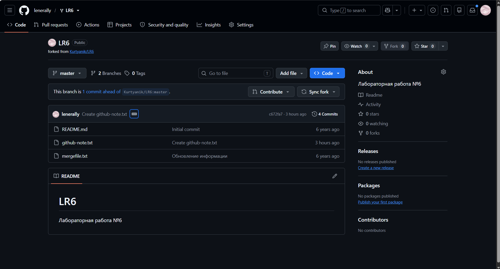

---

### 3.2. Установка и настройка Git

Установлен Git для Windows. Проверены версия, имя автора и email. Имя автора настроено в соответствии с требованиями: 4515 Климина В. А.

```bash
git --version
git config --get user.name
git config --get user.email
```

**Рисунок 2 – Проверка установки и настроек Git**

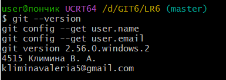

---

### 3.3. Клонирование удалённого репозитория

Личный репозиторий клонирован в каталог D:/GIT6/LR6. Проверены адрес origin и список веток. Обнаружены master и origin/branch1.

```bash
git clone https://github.com/lenerally/LR6.git
cd LR6
git remote -v
git branch -a
```

**Рисунок 3 – Клонирование и просмотр веток**

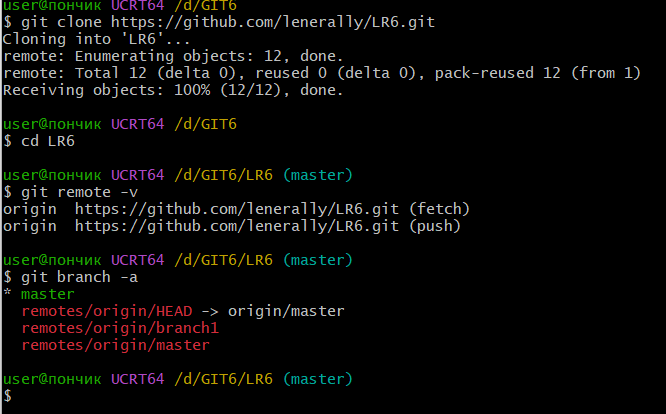

---

### 3.4. Добавление файла через GitHub и проверка синхронизации

Через интерфейс GitHub создан файл github-note.txt. В локальном репозитории выполнена команда git pull origin master. Сообщение Already up to date подтвердило отсутствие новых изменений для получения на момент проверки. Командой cat проверено наличие и содержимое локального файла.

```bash
git pull origin master
cat github-note.txt
```

**Рисунок 4 – Файл, созданный через интерфейс GitHub**

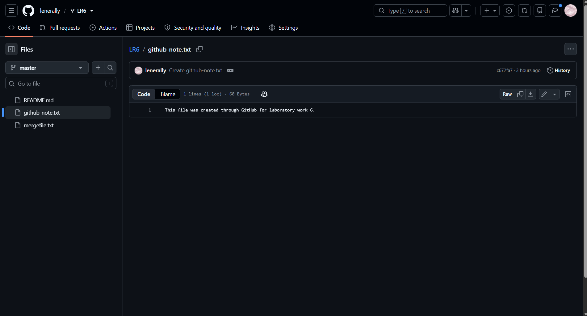

**Рисунок 5 – Проверка синхронизации и содержимого файла**

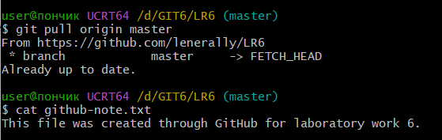

---

### 3.5. Просмотр истории веток

Просмотрены истории master и origin/branch1, а также общий граф коммитов.

```bash
git log master --oneline
git log origin/branch1 --oneline
git log --all --graph --oneline --decorate
```

**Рисунок 6 – История обеих веток**

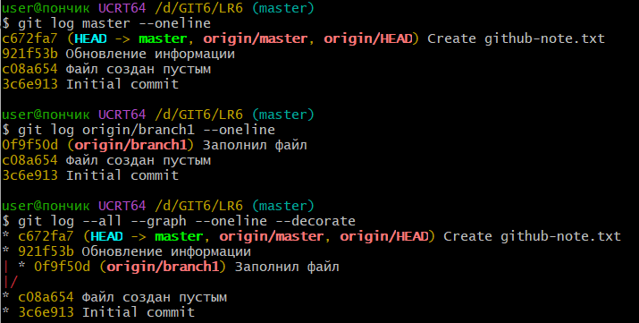

---

### 3.6. Просмотр последних изменений

Просмотрены последний коммит и различия между основной и побочной ветками.

```bash
git show HEAD
git diff master origin/branch1
```

**Рисунок 7 – Последний коммит и различия веток**

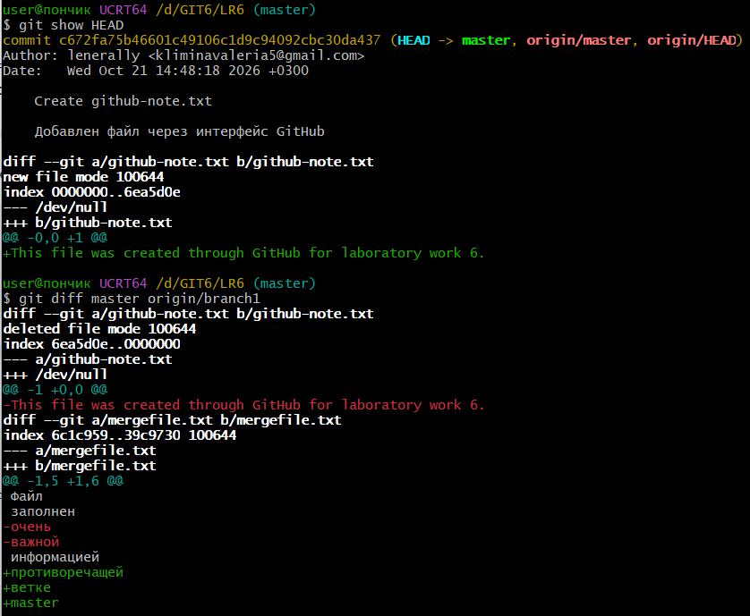

---

### 3.7. Слияние веток и разрешение конфликта

На основе origin/branch1 создана локальная ветка branch1. После переключения в master выполнено слияние. В mergefile.txt возник конфликт изменений. Файл открыт в Блокноте, вручную выбран итоговый текст и удалены маркеры конфликта. Исправление добавлено в индекс, слияние завершено коммитом 4bed0a4.

```bash
git switch -c branch1 --track origin/branch1
git switch master
git status
git merge branch1
git status
notepad mergefile.txt
git add mergefile.txt
git commit -m "Объединены master и branch1, конфликт разрешён"
```

**Рисунок 8 – Возникновение конфликта слияния**

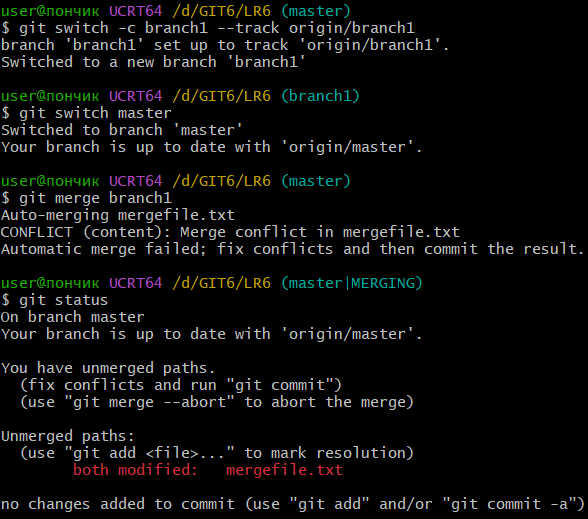

**Рисунок 9 – Содержимое файла после ручного исправления**

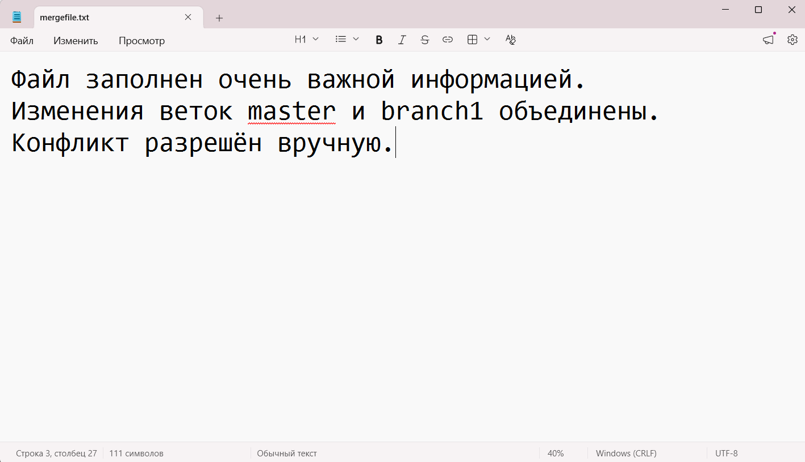

---

### 3.8. Удаление побочной ветки

После успешного слияния локальная ветка branch1 удалена командой с проверкой слитости. На этом этапе в списке локальных веток осталась master.

```bash
git status
git log --graph --oneline --decorate -8
git branch -d branch1
git branch
```

**Рисунок 10 – Завершение слияния и удаление локальной ветки**

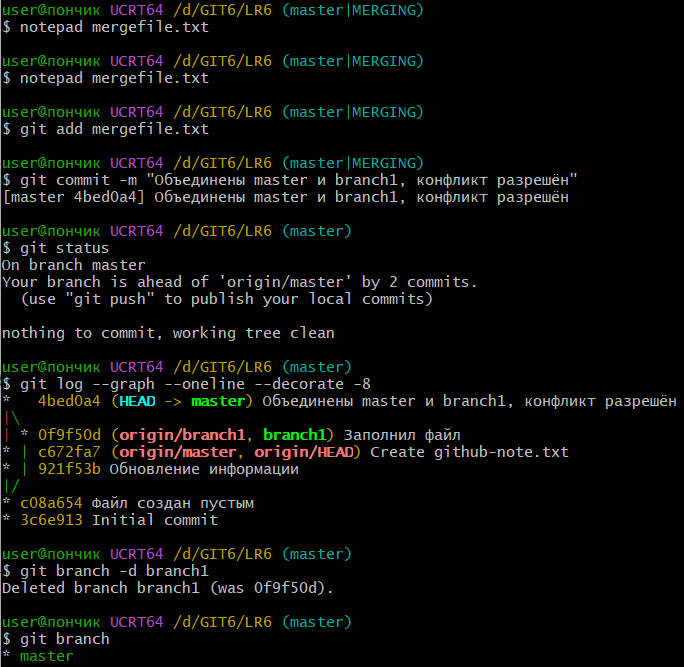

---

### 3.9. Создание нескольких коммитов

В practice.txt последовательно добавлены строки First line, Second line и Temporary line. Каждое изменение сохранено отдельным коммитом: 19f8b1b, f75a841 и 9acf966.

```bash
echo "First line" > practice.txt
git add practice.txt
git commit -m "Создан учебный файл"
echo "Second line" >> practice.txt
git add practice.txt
git commit -m "Добавлена вторая строка"
echo "Temporary line" >> practice.txt
git add practice.txt
git commit -m "Добавлена временная строка"
cat practice.txt
git log --oneline -5
```

**Рисунок 11 – Три последовательных коммита**

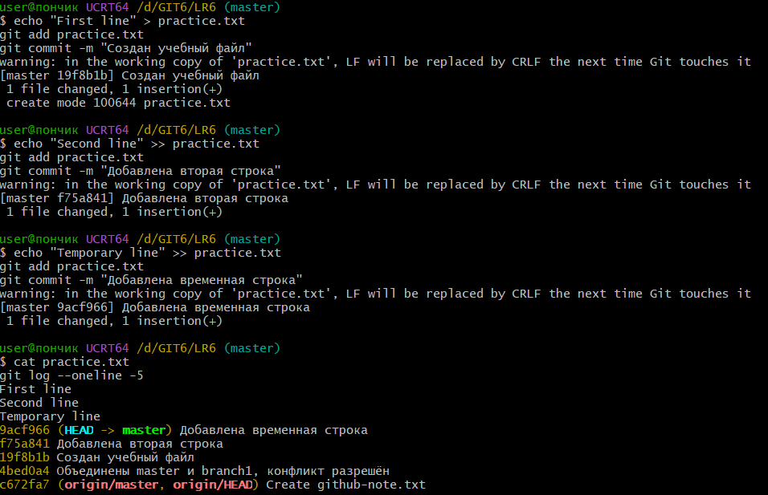

---

### 3.10. Откат коммита

Командой git revert --no-edit HEAD отменено добавление временной строки. Создан коммит отмены 23032ba; исходный коммит сохранён в истории. В файле остались First line и Second line.

```bash
git revert --no-edit HEAD
cat practice.txt
git log --oneline -6
git status
```

**Рисунок 12 – Откат коммита и проверка результата**

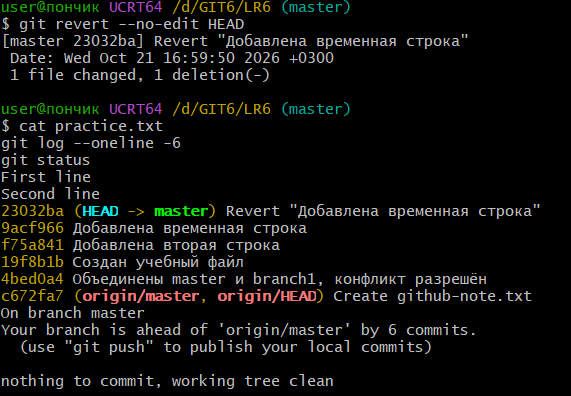

---

### 3.11. Создание ветки для отчёта

Для оформления отчёта создана отдельная ветка otchet.

```bash
git switch -c otchet
```

---

### 3.12. Оформление отчёта в README.md

В ветке otchet оформлен отчёт в Markdown. Изображения размещены в папке screenshots. Промежуточные результаты сохранены коммитами ef88f71 и 92bb40f. Затем исправлено экранирование Markdown, результат сохранён коммитом 854dd57.

```bash
git add README.md screenshots/
git commit -m "Добавлены настройка Git и подготовка репозитория в отчёт"
git add README.md
git commit -m "Добавлены история веток, слияние и откат в отчёт"
sed -i 's/\\//g' README.md
git add README.md
git commit -m "Исправлено Markdown-оформление отчёта"
```

---

### 3.13. Получение форматированной истории

Получена история, содержащая сокращённый хэш, дату, имя автора и комментарий. Ниже приведено состояние истории на момент коммита 854dd57, полученное командой ниже. Коммиты последующего оформления в этот снимок истории не входят.

```bash
git log --all --date=short --pretty=format:"%h | %ad | %an | %s"
```

---

**Таблица 1 – Форматированная история коммитов**

| Сокращённый хэш | Дата | Автор | Комментарий |
|---|---|---|---|
| 854dd57 | 2026-10-21 | 4515 Климина В. А. | Исправлено Markdown-оформление отчёта |
| 92bb40f | 2026-10-21 | 4515 Климина В. А. | Добавлены история веток, слияние и откат в отчёт |
| ef88f71 | 2026-10-21 | 4515 Климина В. А. | Добавлены настройка Git и подготовка репозитория в отчёт |
| 23032ba | 2026-10-21 | 4515 Климина В. А. | Revert "Добавлена временная строка" |
| 9acf966 | 2026-10-21 | 4515 Климина В. А. | Добавлена временная строка |
| f75a841 | 2026-10-21 | 4515 Климина В. А. | Добавлена вторая строка |
| 19f8b1b | 2026-10-21 | 4515 Климина В. А. | Создан учебный файл |
| 4bed0a4 | 2026-10-21 | 4515 Климина В. А. | Объединены master и branch1, конфликт разрешён |
| c672fa7 | 2026-10-21 | lenerally | Create github-note.txt |
| 921f53b | 2020-11-21 | Kurtyanik | Обновление информации |
| 0f9f50d | 2020-11-21 | Kurtyanik | Заполнил файл |
| c08a654 | 2020-11-21 | Kurtyanik | Файл создан пустым |
| 3c6e913 | 2020-11-21 | Kurtyanik | Initial commit |

### 3.14. Финальная фиксация и отправка изменений на GitHub

После завершения оформления отчёта выполнены финальная фиксация и отправка локальных изменений в удалённый репозиторий GitHub.

```bash
git add README.md screenshots/
git commit -m "Отчёт оформлен по образцу, добавлены журнал и история"
git push origin master
git push -u origin otchet
```

После завершения оформления отчёта выполнены финальная фиксация и отправка локальных изменений в удалённый репозиторий GitHub. Отправлены ветки master и otchet.
Проверено отображение README.md, таблицы истории и скриншотов в ветке otchet.

Ссылка на отчёт: https://github.com/lenerally/LR6/tree/otchet
---

## 4. Лог команд

Основные успешно выполненные команды без результатов их выполнения. Основные выполненные команды без результатов их выполнения.

```bash
git --version
git config --get user.name
git config --get user.email
git clone https://github.com/lenerally/LR6.git
cd LR6
git remote -v
git branch -a
git pull origin master
cat github-note.txt
git log master --oneline
git log origin/branch1 --oneline
git log --all --graph --oneline --decorate
git show HEAD
git diff master origin/branch1
git switch -c branch1 --track origin/branch1
git switch master
git status
git merge branch1
git status
notepad mergefile.txt
git add mergefile.txt
git commit -m "Объединены master и branch1, конфликт разрешён"
git status
git log --graph --oneline --decorate -8
git branch -d branch1
git branch
echo "First line" > practice.txt
git add practice.txt
git commit -m "Создан учебный файл"
echo "Second line" >> practice.txt
git add practice.txt
git commit -m "Добавлена вторая строка"
echo "Temporary line" >> practice.txt
git add practice.txt
git commit -m "Добавлена временная строка"
cat practice.txt
git log --oneline -5
git revert --no-edit HEAD
cat practice.txt
git log --oneline -6
git status
git switch -c otchet
git add README.md screenshots/
git commit -m "Добавлены настройка Git и подготовка репозитория в отчёт"
git add README.md
git commit -m "Добавлены история веток, слияние и откат в отчёт"
sed -i 's/\\//g' README.md
git add README.md
git commit -m "Исправлено Markdown-оформление отчёта"
git log --all --date=short --pretty=format:"%h | %ad | %an | %s"
```

---

## 5. Вывод

В ходе лабораторной работы изучены базовые возможности Git и работа с локальным и удалённым репозиториями. Выполнены Fork, клонирование, проверка синхронизации и просмотр истории изменений.

Освоены работа с ветками, слияние, ручное разрешение конфликта и удаление слитой локальной ветки. Созданы последовательные коммиты и выполнена отмена изменения с помощью git revert с сохранением истории.

Отчёт оформлен в Markdown в отдельной ветке otchet, изображения размещены в папке screenshots. В процессе подготовки выполнено несколько промежуточных коммитов.
